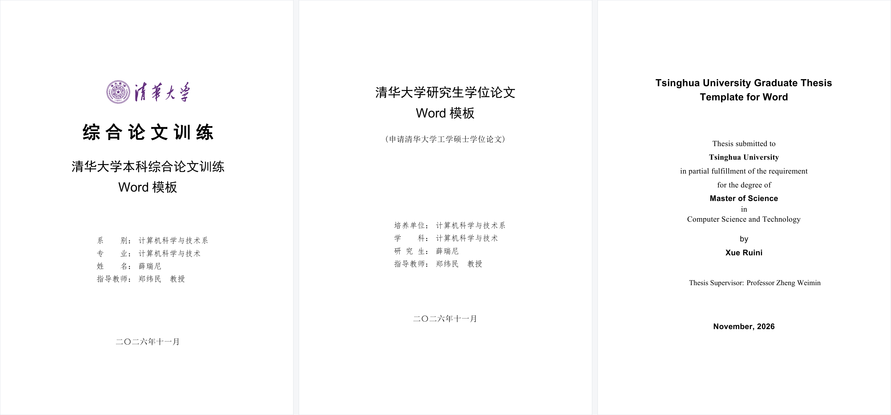

# 清华大学毕业论文 Word 模板

[](https://github.com/fatalerror-i/thuwordthesis)

本项目提供清华大学**本科综合论文训练论文**和**研究生学位论文**两套 Word 模板。模板提供了全面的格式，并支持使用宏进行自动化排版。



## 使用前准备

- 推荐使用 Windows Microsoft Word 2016 或更高版本。模板不保证在 Mac 等系统、WPS 等软件下功能完全可用。
- 推荐安装 XITS Math 字体，模板的公式使用此字体。从 [XITS 官方发布页](https://github.com/aliftype/xits/releases/latest) 下载并安装 `XITSMath-Regular.otf` 和 `XITSMath-Bold.otf` 即可。
- 从源码构建时，需安装 Python 3.11 或更高版本。

## 使用

从 [Releases](https://github.com/fatalerror-i/ThuWordThesis/releases) 或 [百度网盘](https://pan.baidu.com/s/1LDODxkVPQTx366GQayHVGg?pwd=word) 中直接下载 DOTM 模板、DOCX 文档和 PDF 预览。也可以直接从源码构建。

```bash
# 安装依赖
python -m pip install -r requirements.txt
# 生成 DOTM 模板、DOCX 文档和 PDF 预览
python src/build_dotm.py --variant undergraduate  # 本科
python src/build_dotm.py --variant graduate       # 研究生
```

- [快速入门](docs/01-快速入门.md)涵盖新建写作稿、填写封面、编辑与导出。
- [格式定义](docs/02-格式定义.md)汇总两版排版设置、与写作指南的差异及核对方法。
- [常见问题](docs/03-常见问题.md)提供宏、功能区和编号异常的处理方法。
- [开发者文档](.agents/docs/00-index.md)提供构建、调试和测试入口。


## 项目结构

```text
ThuWordThesis/
├─ .agents/                 # 开发者手册
├─ assets/                  # 封面校徽、校名图形和预览图
├─ configs/                 # 格式规则、样式映射、学位选项
├─ docs/                    # 用户手册
├─ output/                  # 构建生成的模板与预览
├─ src/                     # Python 构建脚本
│  ├─ build/                # 文档组装、样式处理、配置读取
│  │  └─ content/           # 示例内容
│  └─ dotm/                 # VBA 宏、窗体、Word 功能区定义
└─ tests/                   # 测试
```

## 版权声明

本项目的代码、文档采用 CC BY-NC 4.0 授权。清华大学校徽与校名标准字相关权利归清华大学所有。

## 参考

- [清华大学综合论文训练写作规范及相关模板文件 - 教务处](https://info.tsinghua.edu.cn/f/info/xxfb_fg/xnzx/template/detail?xxid=b2d1a49d7e48c8e9b0f7e82f033dbb2b)
- [研究生学位论文写作指南 - 研究生院](https://info.tsinghua.edu.cn/f/info/xxfb_fg/xnzx/template/detail?xxid=fa880bdf60102a29fbe3c31f36b76c7e)
- [清华大学视觉形象识别系统手册](https://vi.tsinghua.edu.cn/download/VisualIdentity-cn.pdf)

-  [ThuThesis](https://github.com/tuna/thuthesis)
